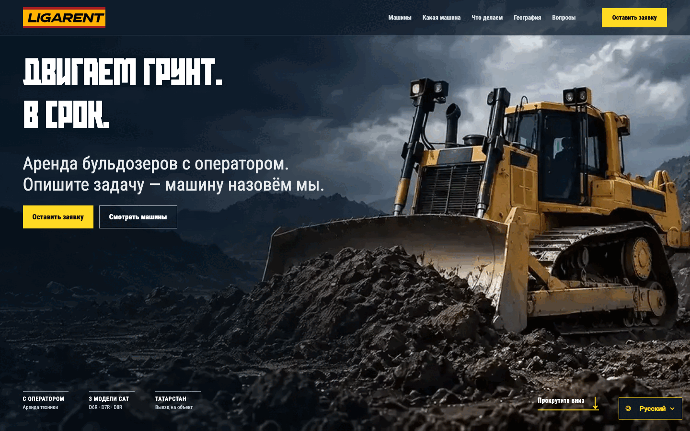
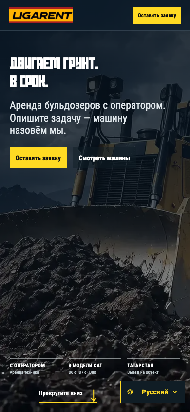

# LIGARENT

A static, five-language website for a bulldozer rental business in Tatarstan: a scroll-driven video intro, a machine picker, job photo albums, a service-area map and an enquiry form that opens a ready-made Telegram message.

This repository is the source of the live site at **https://ligarent.com/** (GitHub Pages, custom domain via `CNAME`). An earlier version is kept in [DominicDamire/ligarent](https://github.com/DominicDamire/ligarent).





## What it does

- **Intro:** `start.html` plays a short opening reel, then a scroll-controlled film that is drawn frame by frame onto a canvas from a bundle of WebP frames (`assets/intro-sequence/`). Scrolling carries the visitor into the site, and scrolling back returns to the film. Visitors can skip the reel.
- **Five languages:** Russian (default), English, Tatar, Simplified Chinese and Spanish, switchable on the intro and the site. The choice is stored in `localStorage` and `?lang=en` (or `ru`, `tt`, `zh`, `es`) overrides it. See `LANGUAGES.md`.
- **Machines:** cards for the Cat D6R, D7R and D8R with spec figures, technical drawings and tilting cards.
- **Machine picker:** a short questionnaire (job, area, ground, site access) that recommends one of the three machines.
- **Work albums:** six photo albums with a dialog and zoom view; photo credits and source links are kept in the dialog and in `assets/sources.md`.
- **Service area:** a Leaflet map of Tatarstan and Bashkortostan on the OpenStreetMap layer, loaded when it scrolls into view.
- **Enquiry form:** collects the site description, location, optional tonnage, contact details and chosen machine, then opens `t.me/ligarent` with the message pre-filled. Nothing is sent automatically.
- **Image cache:** a small service worker (`image-cache-sw.js`) caches images under `/assets/` on HTTPS.

## Tech

Plain HTML, CSS and vanilla JavaScript with no build step. Vendored libraries in `vendor/`: GSAP, Atropos and Leaflet. Intro video is H.264 MP4.

## Run it

```bash
git clone https://github.com/DominicDamire/ligarent-preview.git
cd ligarent-preview
python3 -m http.server 8000
```

Open http://localhost:8000/ (it redirects to `start.html`). The repository is large (about 280 MB) because the intro videos are committed directly.

## Tests

`qa/languages.cjs` is a Playwright end-to-end test. It needs Node, Playwright and an installed Google Chrome (set `CHROME_PATH` to use another Chromium):

```bash
NODE_PATH=/path/to/node_modules node qa/languages.cjs
```

It starts `python3 -m http.server` on port 8766 and checks, at 390 px and 1440 px wide and in all five languages: the headline, no horizontal overflow, the machine picker, every photo album dialog and zoom, the menu, that no Russian text is left in the English, Spanish and Chinese pages, that typed form input is preserved, that the language survives a reload and the embedded intro, and the content of the Telegram draft (the request is intercepted, nothing is sent).

`qa/intro-scroll-regression.cjs` is out of date: it asserts an older intro implementation and currently fails.

## Status / limits

In production at ligarent.com. There is no server side: the enquiry opens a Telegram draft in the visitor's own app, and copy is written Russian-first with the other four languages mapped from it in `translations.js`.

Author: Damire Zalyatov
